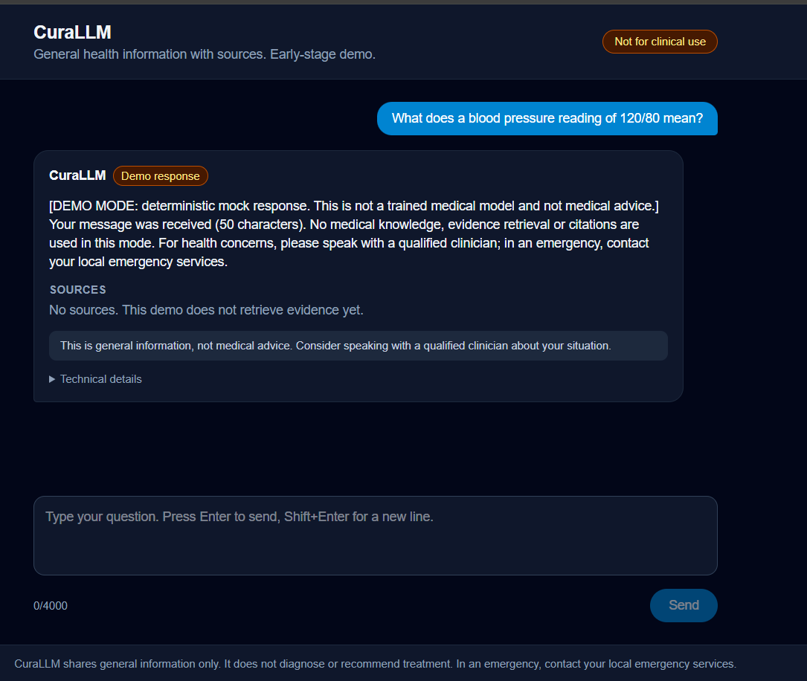

# CuraLLM

[](https://github.com/GargiPareek-27/CuraLLM/actions/workflows/ci.yml)

**An evidence-grounded, uncertainty-aware medical information assistant, built as a research and engineering project.**

> **Not medical advice.** CuraLLM is a portfolio/research project. It does not diagnose, and it does not recommend individual treatment. It is not for clinical use.



*Current state: the chat page talks to a real API, but answers come from a deterministic mock model, so there are no real medical answers or sources yet.*

## Status

This project is at an early stage. Everything not marked "Done" below has **not been built or measured yet**.

| Component | Status |
|---|---|
| Repository setup (license, references, README, .gitignore) | Done |
| Backend foundation: Docker Compose, PostgreSQL + pgvector, FastAPI, mock inference, migration, scripts | Done. CI (lint, unit tests, full-stack smoke test) passes on GitHub's Linux runner, and the stack, scripts and tests also run locally on Windows with Docker Desktop |
| Dataset inspection script (`ml/data/inspect_datasets.py`) | Written, not yet run |
| Web app (Next.js chat page) | Done for Phase 1: lint and build pass, and the page was run in a browser against the Dockerized API, including the error and retry state |
| Data curation pipeline | Not started |
| QLoRA SFT and DPO on Llama-3.1-8B-Instruct | Not started |
| Hallucination taxonomy and hand-labelled evaluation set | Not started |
| Retrieval (RAG) over a public health corpus | Not started |
| Claim-level verification and abstention | Not started |
| Application and UI | Not started |

## Research question

> Does preference optimization (DPO) actually reduce medical hallucination, or does it mainly improve how much people prefer the answers?

A mixed or negative result is an acceptable outcome and will be reported as found.

## What the finished system is meant to do

```
User question
   -> safety / intent check (emergencies, diagnosis requests)
   -> fine-tuned model drafts an answer
   -> claims are extracted from the draft
   -> evidence is retrieved for each claim
   -> each claim is checked: SUPPORTED / UNCERTAIN / CONTRADICTED
   -> the system answers, hedges, or abstains
   -> answer shown with sources and an evidence trail
```

## Planned experiments

Conditions compared on the same held-out, hand-labelled questions: Base, SFT, SFT + DPO, then the same models with retrieval, then retrieval plus verification and abstention.

## Results

| Condition | Hallucination rate | Evidence coverage | Citation accuracy |
|---|---|---|---|
| Base | NOT YET MEASURED | NOT YET MEASURED | NOT YET MEASURED |
| SFT | NOT YET MEASURED | NOT YET MEASURED | NOT YET MEASURED |
| SFT + DPO | NOT YET MEASURED | NOT YET MEASURED | NOT YET MEASURED |
| + RAG | NOT YET MEASURED | NOT YET MEASURED | NOT YET MEASURED |
| + Verification / abstention | NOT YET MEASURED | NOT YET MEASURED | NOT YET MEASURED |

## Repository layout

Files marked **(exists)** are in the repo today; the rest are planned.

```
CuraLLM/
├── README.md, LICENSE, .gitignore, .gitattributes, .env.example, docker-compose.yml
├── apps/web/                  Next.js patient, doctor and admin app (planned)
├── services/
│   ├── api/                   FastAPI: health, chat, later auth, cases, consent
│   └── inference/             model providers (mock now; Ollama and vLLM-compatible planned)
├── ml/
│   ├── data/                  dataset inspection, preparation, validation
│   ├── training/              optional QLoRA SFT (and DPO) experiments (planned)
│   └── evaluation/            retrieval, generation and safety evaluation (planned)
├── scripts/                   setup, dev, stop, migrate, test (bash and PowerShell)
├── tests/                     cross-service integration, security and end-to-end tests (planned)
└── doc/, docs/                References.md (exists); RUNBOOK.md and IMPLEMENTATION_STATUS.md
```

See `docs/ARCHITECTURE.md` for the design and its trade-offs, `docs/IMPLEMENTATION_STATUS.md` for exactly what is written, verified and planned, and `docs/RUNBOOK.md` for commands.

## Compute and environment (measured)

Hardware checked so far is a free Google Colab session: Tesla T4 (15.6 GB), compute capability 7.5, about 12 GiB system RAM. This GPU has no native bf16 support, so training uses fp16 compute. Whether 8B QLoRA SFT and DPO fit on this hardware is **not yet measured**.

## Limitations

- Statistical power will be limited by the size of a hand-labelled evaluation set.
- Retrieved evidence is only as trustworthy as its source.

## License

Code is MIT-licensed. The Llama-3.1 model weights and every dataset have their own licenses, which must be checked before use or redistribution.
