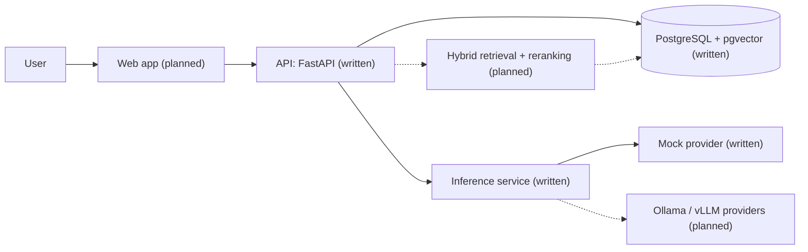

# Architecture

Status key: **written** = code exists but has not been run by the author yet; **planned** = not started. See `docs/IMPLEMENTATION_STATUS.md` for the current state.

## System view

## Target request lifecycle (Phase 2 onward)

1. Validate the request and run safety checks (emergency and diagnosis requests).
2. Retrieve evidence: dense (pgvector) and lexical (PostgreSQL full-text search), combined with Reciprocal Rank Fusion, then reranked.
3. If the evidence is weak, abstain or ask for clarification instead of answering.
4. Generate with a versioned prompt, receiving only the selected passages.
5. Validate the structured output and check every citation against the retrieved passages. Fabricated sources are rejected.
6. Return the answer with citations, limitations and the model and prompt versions.

Today only a thin slice exists: request validation, a call to the mock provider, and a typed response that says it is a demo.

## Design decisions

| Decision | Why | Trade-off |
|---|---|---|
| Separate inference service behind a provider interface | The API stays testable without a GPU, and model backends (mock, Ollama, vLLM) can be swapped by configuration. | One extra network hop and one more service to run. |
| Deterministic mock provider as the default | CI and every developer can run the full stack with no GPU and no paid API key. Responses are labelled as demos. | Mock mode proves plumbing, not model quality. |
| pgvector inside PostgreSQL | One database for relational data, vectors and full-text search keeps hybrid retrieval and access control in one place. | A dedicated vector database may scale better for very large corpora. |
| Reciprocal Rank Fusion for hybrid search | It combines rankings without needing comparable scores from dense and lexical search. | It will be compared against dense-only and lexical-only on a labelled set before any claim is made. |
| Explicit Python pipeline, no orchestration framework | Fewer moving parts and easier to test and explain. | More code to write by hand. |
| Only connection failures are retried | A request that timed out may already have been processed. | A slow model fails the request instead of being retried. |
| Logs contain metadata only | Message text is never logged, to avoid leaking health information. | Debugging needs the request id and safe diagnostics. |

## Not claimed

No clinical validation, no production readiness, no measured accuracy yet. Those claims wait for the evaluation harness (Phase 3) and a security review (Phase 6).
